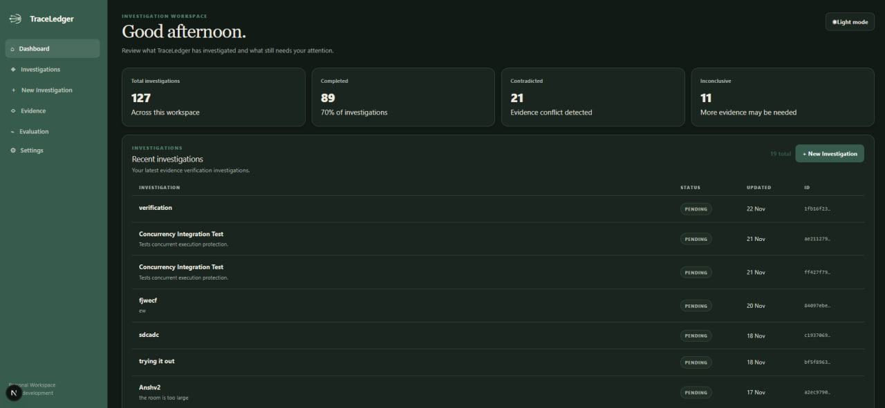
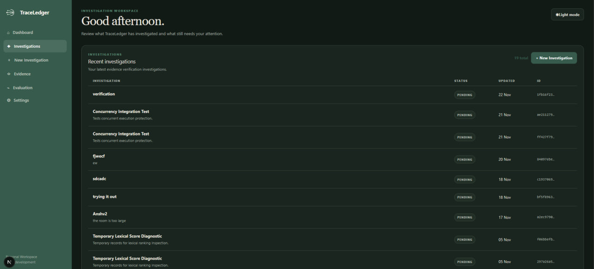
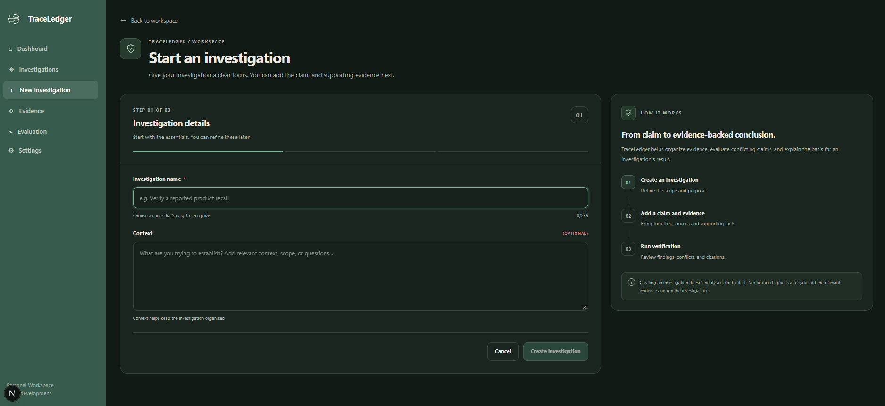
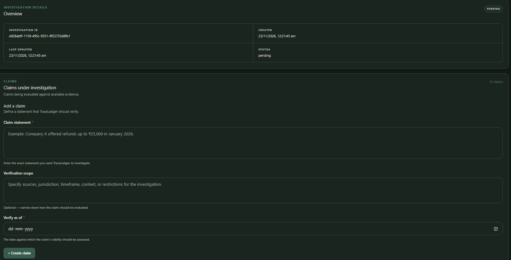

# TraceLedger

**An evidence-driven AI investigation engine for claim verification, temporal reasoning, and traceable conclusions.**

TraceLedger is an AI-powered investigation platform designed to evaluate claims against available evidence, assess source reliability, identify conflicting information, and generate explainable conclusions.

Unlike conventional RAG-based question-answering systems, TraceLedger combines hybrid retrieval, evidence-quality assessment, temporal filtering, and structured LLM-based verification to make investigation results more reliable, transparent, and auditable.

> **Development Status:** TraceLedger is actively under development. Core backend workflows, retrieval, evidence-quality assessment, persistence, and automated tests have been implemented. Frontend integration and advanced verification capabilities are evolving.

---

## Application Preview

### Dashboard



### Investigations



### Create Investigation



### Create Claim



---

## Key Capabilities

### 1. Investigation Management

- Create and manage investigations.
- Organize claims and supporting evidence.
- Track investigation execution and lifecycle.
- Persist investigation results for future inspection.

### 2. Hybrid Evidence Retrieval

- Combines semantic and lexical retrieval approaches.
- Retrieves relevant evidence for submitted claims.
- Uses ranking and relevance-based retrieval to improve evidence discovery.

### 3. Evidence Quality Assessment

Evaluates retrieved evidence across multiple dimensions:

- **Authority:** Reliability and credibility of the source.
- **Freshness:** How recently the information was published or updated.
- **Temporal Validity:** Whether the evidence is relevant to the investigation's time context.
- **Completeness:** Whether the available content provides sufficient information.

### 4. AI-Powered Verification

- Uses Google Gemini for LLM-based analysis.
- Uses LangGraph to orchestrate structured investigation workflows.
- Processes claims against retrieved evidence.
- Generates structured verification results.

### 5. Traceability and Persistence

- Maintains relationships between investigations, claims, and evidence.
- Persists investigation results and supporting information.
- Supports traceable, evidence-grounded conclusions.

### 6. Backend Reliability

- Database transactions for consistent persistence.
- PostgreSQL row-level locking for concurrency control.
- Duplicate persistence protection.
- Investigation lifecycle management.
- Automated unit and integration testing.

> Advanced contradiction handling, comprehensive evaluation, and complete end-to-end integration remain active development areas.

---

## Architecture

```text
                  ┌──────────────────────────┐
                  │       Next.js UI         │
                  │     React + TypeScript   │
                  └────────────┬─────────────┘
                               │
                               ▼
                  ┌──────────────────────────┐
                  │       FastAPI API        │
                  │     REST Endpoints       │
                  └────────────┬─────────────┘
                               │
                               ▼
                  ┌──────────────────────────┐
                  │   Investigation Service  │
                  │                          │
                  │  Claim Processing        │
                  │  Workflow Coordination  │
                  │  Result Persistence      │
                  └────────────┬─────────────┘
                               │
                               ▼
                  ┌──────────────────────────┐
                  │    LangGraph Workflow    │
                  │                          │
                  │  Evidence Retrieval      │
                  │  Evidence Assessment     │
                  │  LLM Verification        │
                  │  Result Generation       │
                  └────────────┬─────────────┘
                               │
                  ┌────────────┴─────────────┐
                  ▼                          ▼
       ┌────────────────────┐     ┌────────────────────┐
       │  Hybrid Retrieval  │     │   Google Gemini    │
       │                    │     │                    │
       │  Dense Retrieval   │     │  LLM Analysis      │
       │  Lexical Retrieval │     │  Structured Output │
       │  Ranking           │     │                    │
       └──────────┬─────────┘     └────────────────────┘
                  │
                  ▼
       ┌────────────────────────┐
       │      PostgreSQL        │
       │                        │
       │  Application Data      │
       │  Evidence Records      │
       │  Investigation Results │
       │  pgvector              │
       └────────────────────────┘
```

---

## Technology Stack

| Layer | Technologies |
|---|---|
| Frontend | Next.js, React, TypeScript, Tailwind CSS |
| Backend | Python, FastAPI |
| AI Orchestration | LangGraph, LangChain |
| LLM | Google Gemini |
| Retrieval | Hybrid Search, Dense Retrieval, Lexical Retrieval, Reciprocal Rank Fusion |
| Database | PostgreSQL, SQLAlchemy, pgvector |
| Data Validation | Pydantic |
| Migrations | Alembic |
| Testing | Pytest, Unit Testing, Integration Testing |
| Code Quality | ESLint, TypeScript |

---

## Project Structure

```text
TraceLedger/
│
├── backend/
│   ├── app/
│   │   ├── agents/
│   │   ├── api/
│   │   ├── core/
│   │   ├── db/
│   │   ├── evaluation/
│   │   ├── models/
│   │   ├── retrieval/
│   │   ├── schemas/
│   │   └── services/
│   │
│   ├── alembic/
│   └── tests/
│
├── frontend/
│   ├── app/
│   ├── components/
│   ├── lib/
│   └── public/
│
├── docs/
│   └── screenshots/
│       ├── dashboard.jpg
│       ├── investigations.jpg
│       ├── create-investigation.png
│       └── create-claim.png
│
├── evaluation/
├── infrastructure/
│
├── README.md
└── ...
```

---

## Getting Started

### Prerequisites

Make sure the following tools are installed:

- Python 3.12
- Node.js and npm
- PostgreSQL with pgvector extension
- Google Gemini API credentials

### 1. Clone the Repository

```bash
git clone https://github.com/anshpandey003/TraceLedger.git
cd TraceLedger
```

### 2. Backend Setup

Create and activate a virtual environment:

```bash
python -m venv .venv
```

Install backend dependencies:

```bash
pip install -e ./backend
```

Configure the required environment variables, including database connection details and Gemini API credentials.

Run database migrations:

```bash
alembic upgrade head
```

Start the FastAPI server:

```bash
uvicorn app.main:app --reload
```

### 3. Frontend Setup

Navigate to the frontend directory:

```bash
cd frontend
```

Install dependencies:

```bash
npm install
```

Start the development server:

```bash
npm run dev
```

The frontend will be available at:

```text
http://localhost:3000
```

### 4. Run Tests

From the backend environment:

```bash
pytest
```

### 5. Frontend Validation

```bash
npm run lint
npm run build
```

---

## Engineering Principles

TraceLedger is built around the following engineering principles:

- **Evidence First:** Conclusions should be grounded in retrieved and inspectable evidence.
- **Traceability:** Important conclusions should be connected to their supporting evidence.
- **Temporal Awareness:** Evidence must be evaluated in the context of the investigation's relevant time.
- **Separation of Concerns:** Retrieval, evidence assessment, verification, and persistence should remain independently manageable.
- **Deterministic Reliability:** Database consistency, validation, and execution safeguards should not depend solely on LLM behavior.
- **Testability:** Core workflows should be covered by automated tests.

---

## Development Roadmap

- [x] Backend application foundation
- [x] Investigation and claim management
- [x] Database models and persistence
- [x] Evidence retrieval foundation
- [x] Hybrid retrieval implementation
- [x] Evidence-quality assessment
- [x] Gemini integration
- [x] LangGraph workflow foundation
- [x] Backend unit and integration testing
- [ ] Advanced contradiction detection and handling
- [ ] Comprehensive evaluation framework
- [ ] Complete frontend/backend end-to-end integration
- [ ] Failure recovery and execution lifecycle improvements
- [ ] Security hardening
- [ ] Performance evaluation and optimization
- [ ] Deployment and production readiness

---

## Contributing

TraceLedger is currently under active development.

Suggestions, bug reports, and contributions are welcome. Feel free to open an issue or submit a pull request.

---

## License

No open-source license has been specified yet.

---

**TraceLedger — Making AI-driven investigations evidence-based, time-aware, and traceable.**
